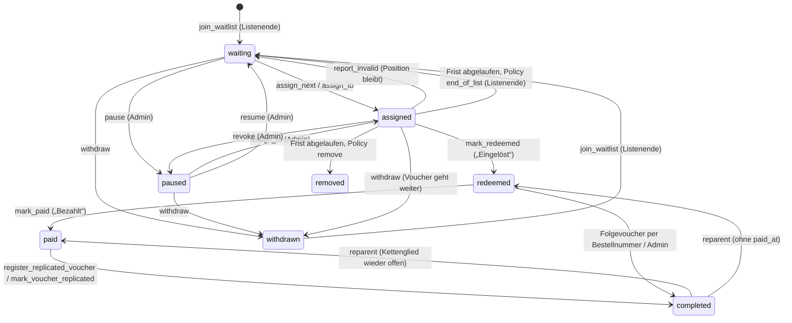
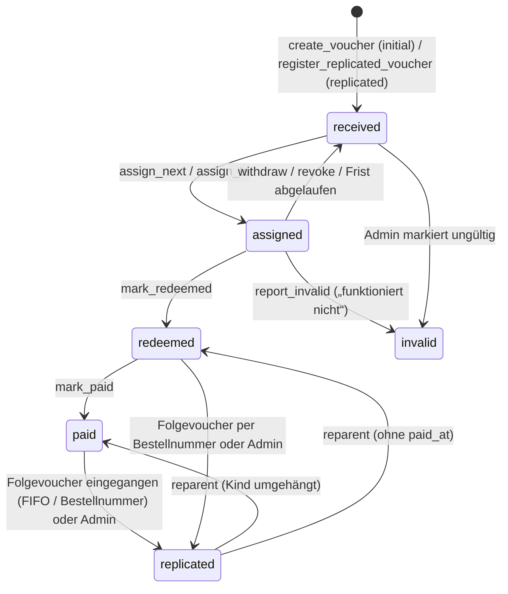
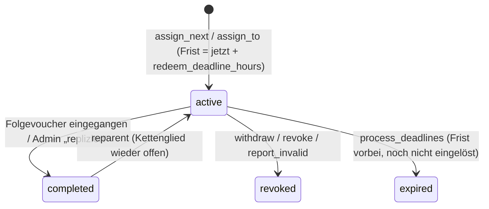

# Zustände

Alle Übergänge laufen über `voucher/services.py`. Ein Übergang, der nicht zum aktuellen
Zustand passt, wirft `InvalidTransition` und ändert nichts.

## TicketRequest

## Voucher

## Assignment

Pro Voucher und pro TicketRequest gibt es höchstens eine aktive Assignment
(Partial-Unique-Constraints in der Datenbank).
